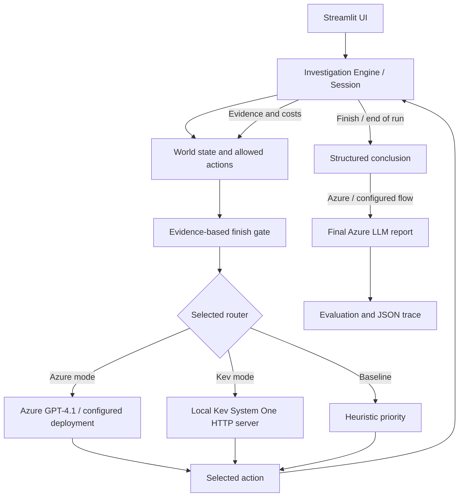

# Hogwarts — The Vanishing Hour 🕰️

**An interactive AI decision-routing lab: Azure GPT vs. a local Kev Decision Model**

> **Demo / research prototype.** A single branching mystery is used to study how different agents choose their *next action* under a limited investigation budget. The project is not a general-purpose detective agent or a production benchmark.
>
> Fan-inspired, unofficial demonstration. Not affiliated with or endorsed by the Harry Potter rights holders.

## Table of contents

1. [What is this project?](#1-what-is-this-project)
2. [How the solution evolved](#2-how-the-solution-evolved)
3. [Architecture](#3-architecture)
4. [Repository structure](#4-repository-structure)
5. [Prerequisites](#5-prerequisites)
6. [Windows 11: install and launch Hogwarts](#6-windows-11-install-and-launch-hogwarts)
7. [Configure Azure AI Foundry](#7-configure-azure-ai-foundry)
8. [Run Kev locally on Windows](#8-run-kev-locally-on-windows)
9. [Run the demonstration](#9-run-the-demonstration)
10. [How action selection works](#10-how-action-selection-works)
11. [Evaluation and real example results](#11-evaluation-and-real-example-results)
12. [Kev Decision Lab: reproducing the routing experiments](#12-kev-decision-lab-reproducing-the-routing-experiments)
13. [Tests and troubleshooting](#13-tests-and-troubleshooting)
14. [Limitations and future work](#14-limitations-and-future-work)
15. [Publishing safely on GitHub](#15-publishing-safely-on-github)

---

## 1. What is this project?

At midnight, Hogwarts loses an entire hour. A Chronos crystal appears to be missing. Witnesses, magical anomalies and misleading clues point in different directions. An investigator must determine:

- **Responsibility:** Who caused the incident?
- **Cause:** What actually happened?
- **Restoration:** How can the missing hour be restored?

The investigator starts with an **action budget of 16 points**. Investigations consume budget, reveal evidence and unlock further actions. The objective is to **solve the mystery reliably with as little unnecessary investigation as possible**.

The central research question is not *which LLM to use*, but:

> **Can a small, local Decision Model select good investigation actions faster and with fewer paid cloud tokens than a general-purpose LLM?**

Supported interfaces/modes in the tested app:

| Mode | Next-action selection | Final assessment |
|---|---|---|
| Human | Player | Player |
| Rule-based baseline | Fixed, non-omniscient priority list | Player / configured flow |
| Azure LLM | Azure-deployed LLM (e.g., GPT-4.1) | Azure LLM |
| Kev + Azure conclusion | Local Kev-0.8B via System One HTTP | Azure LLM |

**Important:** The Kev mode is **not completely LLM-free**: its final structured report still uses Azure. The code does not include a running Jev integration or a Harness² training loop.

## 2. How the solution evolved

This repository documents an iterative engineering experiment. The steps below are development milestones, not independent benchmark datasets.

### Phase 1 — From simple cases to a stateful mystery

The first version consisted of several relatively simple cases. They were not sufficiently discriminative: agents could frequently solve them without meaningful sequential planning. The demo was redesigned as **one connected mystery** with:

- An observable `State` containing budget, completed actions and evidence.
- A catalog of actions with costs and prerequisites.
- Dependencies such as `inspect_tower` → `analyze_clock` → `decode_rune` → `inspect_chamber` → `stabilize_crystal`.
- Red-herring actions, such as interviews and library investigations.
- A private evaluator, separated from the information available to the router.

The three scenario IDs in `world.py` provide variants of the same mystery; they **share the essential solution path**. They are not three independent problem families.

### Phase 2 — Azure LLM action router

Added an Azure AI Foundry router using the OpenAI Python SDK and Microsoft Entra ID authentication.

At each step, the LLM receives **only observed evidence, remaining budget, completion readiness and currently allowed actions**. It must return a structured choice, such as:

```json
{"action": "decode_rune", "reason": "The clock analysis revealed a rune code."}
```

The app records the actual response usage, latency and selected action. The project uses the **Responses API** by default. Some model deployments reject a fixed `temperature`, so the code does not force that parameter.

### Phase 3 — Autonomous finish and evidence gate

Added a `FINISH_INVESTIGATION` action and a deterministic `finish_readiness()` check:

- Evidence supports attribution to a responsible actor.
- The cause has been investigated.
- The restoration action has actually been executed.

The gate reads **public evidence and completed actions**, not hidden scenario truth. Until the prerequisites are satisfied, `FINISH_INVESTIGATION` is not offered to either the Azure or Kev router. The gate prevents premature submission; it **does not guarantee correct routing**.

### Phase 4 — Local Kev decision router

Integrated the open-weight **Kev-0.8B** server via `POST /v1/systemone`, using a `choice` question whose criteria are the valid action IDs and descriptions.

Kev supplies the next action; Azure still prepares the final structured report. The adapter validates that Kev's choice belongs to the supplied candidates. If the Kev server errors, the app surfaces the error rather than silently treating heuristic decisions as Kev output.

### Phase 5 — Controlled decision experiments

Investigated why Kev repeatedly chose to interview Luna rather than decode the runes **after `analyze_clock` had already revealed a rune code**.

Used a separate read-only `kev_decision_lab.py` with a frozen state, testing:

- Candidate ordering and number of candidates.
- More explicit action descriptions.
- Goal-focused instructions.
- Equalized *displayed* action costs (diagnostic only).
- Consistent German-language instructions.
- Links from already observed evidence to available actions.
- Generic evidence-aware descriptions and an additional priority instruction.

These experiments changed Kev's choice scores, but **did not establish a consistently better action-selection policy**. The functional Kev v1 router remained the preferred reference implementation.

### Phase 6 — Streamlit UI redesign

Redesigned the interface with a dark hero section, red accents, clearer metrics and a more presentation-friendly decision-trace view. The UI styling is separate from the engine and routing logic.

## 3. Architecture



**Separation of concerns**

- `mystery/world.py`: action catalog, prerequisites, observations, `finish_readiness()`, evaluation and hidden answer key.
- `mystery/engine.py`: session state, step execution, concluding a case and report export.
- `mystery/routers.py`: Azure, Kev and heuristic routing adapters.
- `app.py`: Streamlit presentation and user interaction.

The hidden `SCENARIOS` answers are used by the evaluator, **not included in the router prompt**. Because the world and answer key live in the same local codebase, this is an experimental separation, not a security boundary against adversarial code access.

## 4. Repository structure

Recommended public repository layout:

```text
hogwarts-vanishing-hour/
├── app.py                      # Streamlit UI (styled version)
├── mystery/
│   ├── __init__.py
│   ├── world.py                # State, actions, evidence, evaluation
│   ├── engine.py               # Game sessions and traces
│   └── routers.py              # Azure, Kev and heuristic adapters
├── tests/
│   └── ...                     # Unit / mocked integration tests
├── kev_decision_lab.py         # OPTIONAL: isolated diagnostic experiments
├── requirements.txt
├── .env.example                # Placeholders, never real credentials
├── .gitignore
├── pytest.ini
└── README.md
```

The UI redesign download contains an updated `app.py` only; use it **together with** the original `mystery/`, `tests/` and other project files. Do **not** upload or commit the cloned Kev repository as part of this project: document it as an external dependency.

## 5. Prerequisites

- Windows 11, PowerShell, VS Code (recommended).
- A compatible Python version; **Python 3.11** is a reasonable starting point for the Hogwarts app. Check the Kev repository's Python compatibility separately.
- Git, for cloning dependencies and publishing.
- An Azure AI Foundry project with a deployed model, **if using Azure or Kev's Azure final report**.
- Access to authenticate with Microsoft Entra ID (Azure CLI is convenient).
- Optional local GPU for Kev. Kev was tested in this development setup on an NVIDIA RTX 4070 Laptop GPU; no specific hardware configuration guarantees compatibility.

Hogwarts itself can launch without Azure credentials; **Azure calls still require valid authentication** when you start an Azure-based mode.

## 6. Windows 11: install and launch Hogwarts

Open PowerShell in the Git repository directory:

```powershell
cd "C:\path\to\hogwarts-vanishing-hour"
py -3.11 -m venv .venv
.\.venv\Scripts\Activate.ps1
python -m pip install -r requirements.txt
```

The application's `requirements.txt` includes:

```text
streamlit>=1.39,<2
openai>=1.60,<3
azure-identity>=1.19,<2
python-dotenv>=1.0,<2
pytest>=8,<10
pandas>=2.1,<3
httpx>=0.27,<1
```

If you use a different Python version, verify compatibility with all installed packages.

Copy the configuration template:

```powershell
Copy-Item .env.example .env
```

Run the tests, then the app:

```powershell
python -m pytest -q
python -m streamlit run app.py
```

Streamlit normally opens a local URL such as `http://localhost:8501`.

**Windows note:** The app and Kev can be run in two terminals using the **same activated venv**, but avoid `uv sync` on a separate Kev checkout while that shared environment is active. In the original development this caused permission/lock issues. A separate venv for Kev is often cleaner if version constraints allow.

## 7. Configure Azure AI Foundry

Set **your own** deployed endpoint and deployment name in `.env`:

```dotenv
# Replace the placeholders with your Azure resources.
AZURE_OPENAI_ENDPOINT=https://<your-foundry-resource>.services.ai.azure.com/openai/v1
AZURE_OPENAI_DEPLOYMENT=gpt-4.1
AZURE_OPENAI_API_MODE=responses
AZURE_OPENAI_TOKEN_SCOPE=https://ai.azure.com/.default

# Set only if you know the actual rates. Zero = cost not configured.
AZURE_INPUT_USD_PER_1M=0
AZURE_OUTPUT_USD_PER_1M=0

# Kev local HTTP endpoint
KEV_BASE_URL=http://127.0.0.1:8009
KEV_MODEL=kev-latest
KEV_TIMEOUT_SECONDS=120
```

Log in through Azure CLI (if required by your local setup):

```powershell
az login
```

The implementation uses `DefaultAzureCredential()` and `get_bearer_token_provider(..., "https://ai.azure.com/.default")` rather than embedding API keys in code. Your Azure identity must have the required permissions on the Foundry resource. If your organization uses a different endpoint or identity configuration, adjust it accordingly.

**Deployment note:** A name like `gpt-4.1` is a **deployment identifier configured in your Azure resource**, not something this repository automatically creates. `gpt-5.6-sol` was also tested during development; availability is resource-dependent.

## 8. Run Kev locally on Windows

Kev is a **separate third-party project**. This repository talks to its local HTTP service; the Kev model weights are not redistributed here.

**Official source:** https://github.com/jaredpalmer/kev

### 8.1 Obtain the Kev source

In a separate terminal, navigate to a directory **outside** the Hogwarts Git repository:

```powershell
cd "C:\path\to\your-projects"
git clone https://github.com/jaredpalmer/kev.git
cd kev
```

> Review the Kev repository's current README, license, Python version requirements and model license before publishing or deploying. Its dependencies and launch commands may change.

### 8.2 Install the inference dependencies

If using your existing Python environment, start with the dependencies required by the server. The following were needed in the Windows development session:

```powershell
python -m pip install "fastapi" "uvicorn[standard]" transformers accelerate safetensors huggingface_hub peft
```

**Also install the exact dependencies specified in Kev's own packaging/configuration.** The line above is a record of missing packages encountered during development, **not a guaranteed complete or officially supported Kev installation procedure**. In particular, GPU-enabled PyTorch must be installed in a CUDA-compatible build if you want GPU inference. Follow the PyTorch and Kev instructions for your device rather than blindly replacing a working `torch` installation.

Check Python and optional GPU support:

```powershell
python --version
python -c "import torch; print('CUDA available:', torch.cuda.is_available())"
```

A `False` result means PyTorch currently does not see a CUDA device; it does not by itself prove that Kev cannot run in another supported configuration.

### 8.3 Start the Kev HTTP server

From the cloned Kev source directory, with an environment containing Kev and its dependencies:

```powershell
python -m kev.serve --run jaredpalmer/kev-0.8b --port 8009
```

On the first run, the server may download model/adaptor files from Hugging Face. Subsequent starts can reuse cached files. The server must remain running in **Terminal 1**.

### 8.4 Verify the local server

Open **Terminal 2**:

```powershell
Invoke-RestMethod http://127.0.0.1:8009/openapi.json
```

If the OpenAPI document is returned, the HTTP service is reachable. This is a connectivity check, **not proof that actual inference works**; the best end-to-end test is one Kev action in the Hogwarts app.

### 8.5 Launch Hogwarts alongside Kev

In Terminal 2, open the Hogwarts repository and activate the app environment:

```powershell
cd "C:\path\to\hogwarts-vanishing-hour"
.\.venv\Scripts\Activate.ps1
python -m streamlit run app.py
```

In the sidebar select **Kev Decision Router + Azure Abschluss**. Kev selects the action using `POST http://127.0.0.1:8009/v1/systemone`. Azure is called for the final report.

**Do not confuse Kev with Jev:** the executable `jev.exe`/jevos is **not required** for this demo.

## 9. Run the demonstration

1. Open the Streamlit app and read the story.
2. Choose **Variant 1** (`scenario_id=0`) and **budget 16**.
3. Run **Azure LLM (Foundry)** using **Nächster KI-Schritt** or the automatic option.
4. Watch evidence unlock the next actions. The app shows the completion-readiness checks.
5. Finish the case, export its JSON trace.
6. Click **Neues Spiel**, keep the same scenario and budget, switch to **Kev Decision Router + Azure Abschluss**.
7. Repeat, export the Kev trace, and compare decisions, total budget, wall time and token origin.

**Keep the final Azure deployment consistent between runs** so the comparison is primarily about routing rather than a different report generator.

### Expected evidence chain in the demonstrated case

```text
inspect_scene → inspect_tower → analyze_clock
                            → decode_rune → inspect_chamber → stabilize_crystal
```

The scene inspection helps explain the investigation but is not required by the **omniscient** minimum-cost action chain. Interviews and archive lookups are available, but may consume budget without proving the cause or responsibility.

## 10. How action selection works

### Azure mode

1. `options(state)` filters completed, locked and unaffordable actions.
2. `finish_readiness(state)` determines whether the finish option can be offered.
3. The LLM receives the publicly observed state and allowed action IDs.
4. It returns `{ "action": "...", "reason": "..." }`.
5. The engine validates and executes the action, then logs evidence and usage.

### Kev mode

Kev uses a **System One `choice` request**, conceptually:

```json
{
  "state": "<JSON string of public state>",
  "model": "kev-latest",
  "questions": {
    "next_action": {
      "type": "choice",
      "instructions": "Select the best NEXT action based only on observed evidence...",
      "criteria": {
        "inspect_scene": "Tatort untersuchen. ... Cost: 1 budget points.",
        "inspect_tower": "Astronomieturm untersuchen. ... Cost: 2 budget points."
      }
    }
  }
}
```

The criteria above are **illustrative**; the live candidate list is built dynamically from the allowed actions. Kev returns a chosen candidate, and, depending on the server response, confidence/probabilities and token usage. It is **not asked to write a free-form detective explanation**.

When the investigation is finished, the Azure LLM produces a structured answer with responsibility, cause and restoration. `evaluate()` checks it against the private scenario truth and evidence requirements.

### What counts as an action?

`FINISH_INVESTIGATION` is a **decision** but not a paid investigation action in the game's `state.done` count. The final Azure report appears in `decisions` as an additional `FINAL` record. This distinction matters when comparing **6 vs. 9 investigation actions** with **7 vs. 9 routing selections**.

## 11. Evaluation and real example results

Below are **two actual observed single runs** on the same scenario (`scenario_id=0`) and 16-point budget. These are examples, not statistically significant benchmark averages.

| Metric | GPT-4.1 (Azure routing + report) | Kev-0.8B (local routing + Azure report) |
|---|---:|---:|
| Case solved | Yes | Yes |
| Investigation actions | **6** | 9 |
| Budget used | **10 / 16** | 16 / 16 |
| Remaining budget | 6 | 0 |
| Total wall-clock duration | **24.81 s** | 25.97 s |
| Summed model-call latency, including report | 17.55 s | **11.04 s** |
| Routing-only call latency | ~15.70 s | **~1.83 s** |
| Total reported tokens | 5,567 | 6,762 |
| Azure-reported tokens | 5,567 | **854** |
| Locally processed Kev-reported tokens | 0 | 5,908 |
| Router fallbacks | 0 | 0 |
| Stop reason | `agent_chose_finish` | `manual_or_external_finish` |

**Observed GPT path:**

```text
inspect_scene → inspect_tower → analyze_clock → decode_rune
              → inspect_chamber → stabilize_crystal → FINISH_INVESTIGATION
```

**Observed Kev path:**

```text
inspect_tower → inspect_scene → analyze_clock
              → interview_luna → search_library → interview_draco
              → decode_rune → inspect_chamber → stabilize_crystal
```

### How to interpret the result

- Kev's individual local choices were **much faster**, and the solution used roughly **85% fewer Azure tokens** in this sample.
- Kev selected **three additional detours costing six budget points** before continuing the central evidence chain.
- The Kev run processed **more total tokens across both models**; local model tokens are **not priced like Azure API tokens**.
- The full Kev run was **not faster end-to-end** in this pair of tests. Azure conclusion latency and application overhead also contribute.
- The `estimated_cost_usd` field remains `0` if price settings were left at zero. **This means price not configured, not proven free of cost.** Local GPU electricity/hardware is not tracked.
- Kev did **not autonomously call `FINISH_INVESTIGATION`** in this sample; termination was external/manual.
- The minimum omniscient path costs `9` points; that is a **clairvoyant theoretical lower bound**, not a fair agent baseline.

> **Do not claim these results establish that GPT-4.1 is universally superior or that Kev always saves money.** The benchmark is small and its scenarios are highly similar.

## 12. Kev Decision Lab: reproducing the routing experiments

The optional `kev_decision_lab.py` freezes a **known public state after `inspect_tower`, `inspect_scene`, `analyze_clock`**. It does not execute further world actions after taking the snapshot. This isolates how request formatting changes Kev's next choice.

With Kev running locally:

```powershell
python kev_decision_lab.py --dry-run --stage after_clock --out kev_lab_evidence_clock
python kev_decision_lab.py --repeats 1 --stage after_clock --out kev_lab_evidence_clock
```

**These commands require the latest Evidence-aware Decision Lab edition**; the older lab script did not support `--stage` or experiments I/J. Include that exact edition in your repository if you document these commands.

Diagnostics include:

| Variant | Change |
|---|---|
| A | Original Kev v1 decision request |
| B | Reverse/rotated option order |
| C | More explicit rune description |
| D | Goal-focused instructions |
| E | Only two candidates (diagnostic; not a fair full-router test) |
| F | Displayed costs equalized (without changing world costs) |
| G | German-language question and criteria |
| H | Explicit `OBS_CLOCK` link to the rune action |
| I | Generic evidence-to-action links from observed prerequisites |
| J | I plus a prioritization instruction |

Example findings from **one frozen state**:

| Variant | Chosen action | P(`decode_rune`) | P(`interview_luna`) |
|---|---|---:|---:|
| A original | `interview_luna` | 0.1596 | 0.2327 |
| H explicit link | `interview_luna` | 0.2143 | 0.2192 |
| I generic evidence-aware | `interview_draco` | 0.1492 | 0.1410 |
| J evidence + priority | `interview_draco` | 0.1369 | 0.1452 |

The experiments **did not identify a reliable universal prompt improvement**. Choice-score changes are not equivalent to full-game gains. For research, change one factor at a time, preserve complete candidate probabilities and test multiple substantially different mysteries.

The Decision Lab saves `requests.json`, `results.csv`, and `results.json`. They are reproducibility artifacts, not app dependencies.

## 13. Tests and troubleshooting

### Run unit tests

```powershell
python -m pytest -q
```

The project tests world rules, finish gating, routing contracts and selected mocked interactions. **Passing tests does not verify live Azure credentials or live local Kev inference**.

### `ModuleNotFoundError: No module named 'dateutil'`

A previously used shared venv reported `python-dateutil` installed while its module files were missing. Repair only the package:

```powershell
python -m pip uninstall -y python-dateutil
python -m pip install --no-cache-dir python-dateutil
python -c "import dateutil, pandas; print('Imports OK')"
python -m pip check
```

### Azure authentication error

- Verify `.env` URL, deployment name and `AZURE_OPENAI_TOKEN_SCOPE`.
- Run `az login` with an identity authorized to use the deployment.
- Check that your installed Azure Identity and OpenAI SDK versions are compatible.
- Do not commit token caches, credentials or error logs containing secrets.

### Kev reports `ModuleNotFoundError: No module named 'peft'`

```powershell
python -m pip install peft
```

If more dependencies are missing, refer to Kev's own declared install requirements; avoid guessing arbitrary versions.

### Kev server not reachable

Confirm the Kev terminal is still running on port `8009`, then:

```powershell
Invoke-RestMethod http://127.0.0.1:8009/openapi.json
```

A successful OpenAPI request does not guarantee model loading or inference; run one action from the app to test the full path.

### `jev.exe` access denied

`jev.exe` belongs to a **different project (jev/jevos)**, not to Kev. On one managed Windows 11 machine, Windows Defender Exploit Guard blocked that executable (event ID `1121`); the issue was not fixed by changing file permissions. **Do not disable enterprise security controls to run it.** This demo does not depend on jevos.

### Kev stops too early / wastes budget

- Ensure the repository uses the **evidence-gated** version of `world.py`, `routers.py` and `engine.py`.
- Export the full JSON trace and inspect the actual candidate scores, selected actions and `stop_reason`.
- More prompt text did not reliably improve Kev in the recorded experiments; avoid claiming otherwise.

## 14. Limitations and future work

**Current limitations**

- Tiny benchmark: three closely related variants, almost identical optimal solution path.
- Hard-coded world and deterministic observations; limited transfer to realistic environments.
- Public-evidence finish gate is explicitly engineered into the workflow.
- The final report in Kev mode still requires Azure.
- No trained reinforcement-learning policy, LightGBM ranker or Harness² self-improvement loop is implemented in this repository.
- No active Jev/jevos integration.
- No calibrated monetary cost model for local GPU compute or Azure billing.
- Model choices are validated, but probabilistic decision scores are not automatically calibrated correctness estimates.

**Possible next experiments**

1. Add genuinely different mysteries, varying action graphs, causes, budgets and misleading evidence.
2. Compare GPT-4.1 with smaller generative models, a local model and a learned policy.
3. Train an action-ranking model on a held-out dataset, not only the existing three seeds.
4. Separate *router latency*, *tool execution latency* and *final report latency* in the dashboard.
5. Test robustness to candidate ordering and prompt language.

## 15. Publishing safely on GitHub

### Before the first commit

Ensure your `.gitignore` includes at least:

```gitignore
.env
.env.*
!.env.example
.venv/
__pycache__/
.pytest_cache/
results/
kev_lab_results*/
kev_lab_evidence*/
*.log
```

Review `.env.example` before publishing. Use **placeholder endpoints**, not internal resource names, credentials or private tenant information. A resource URL is not usually a secret, but it can still reveal internal infrastructure details.

Review all files for:

- API keys, access tokens, tenant/subscription identifiers and connection strings.
- Names, paths and logs that identify internal systems or colleagues.
- Trace files containing confidential prompts, client data or account information.
- Third-party models and code whose licenses or redistribution terms differ from the app's.

Also choose a license **only after confirming you are allowed to release the code** and have checked all third-party terms. No license is added automatically by this README.

### Initialize and publish

Create an empty repository on GitHub first, then in the clean project directory:

```powershell
git init
git add .
git status
git commit -m "Initial public demo: Hogwarts AI decision lab"
git branch -M main
git remote add origin https://github.com/<your-username>/<repository-name>.git
git push -u origin main
```

**Inspect `git status` and staged changes carefully before committing.** If credentials have already been committed, removing them from the latest working tree is not sufficient: rotate them and remove them from Git history using an approved process.

---

## Acknowledgements and references

- [Kev by Jared Palmer](https://github.com/jaredpalmer/kev) — local Decision Model / System One server (external dependency).
- [Microsoft Azure AI Foundry documentation](https://learn.microsoft.com/en-us/azure/ai-foundry/) — cloud model deployment and inference.
- [OpenAI Python SDK](https://github.com/openai/openai-python) — Responses API client.
- [Azure Identity for Python](https://learn.microsoft.com/en-us/python/api/overview/azure/identity-readme) — Microsoft Entra ID authentication.
- [Streamlit](https://docs.streamlit.io/) — interactive demonstration interface.

**Disclaimer:** Hogwarts/Harry Potter references are used solely for a noncommercial, unofficial fan-inspired technical demonstration. All related marks and fictional settings belong to their respective rights holders.
